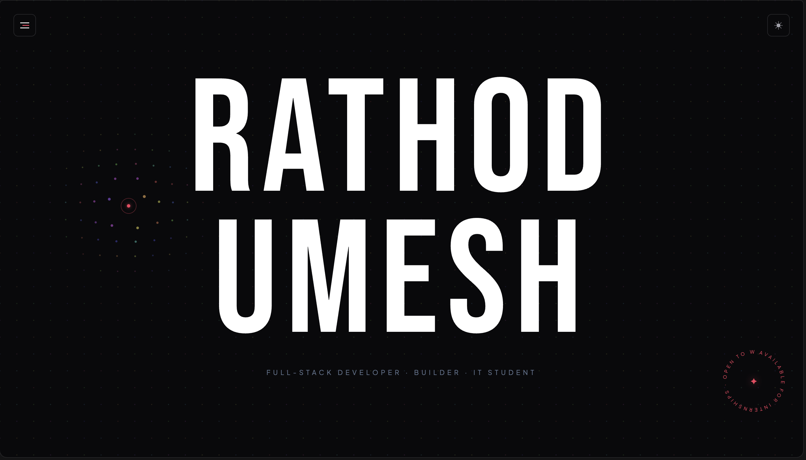

# Umesh Rathod | Portfolio

Personal developer portfolio showcasing my projects, technical skills, experience, and journey in software development. Built with React and Vite, featuring a minimal dark interface, crimson accents, and smooth animations.

## Preview



## Stack

- React + Vite
- Tailwind CSS
- Framer Motion for animations
- Lenis for smooth scrolling
- React Icons
- JavaScript (ES6+)

## Features

- Responsive design with a minimal dark theme
- Smooth scrolling and scroll-triggered animations
- Interactive navigation with active section tracking
- About, Skills, Projects, Experience, and GitHub sections
- Blog integration and social links
- Contact section with email and resume links
- Custom favicon and crimson accent styling

## Run Locally

```bash
git clone <https://github.com/UMESHRATHOD16/Portfolio-main.git>
cd <portfolio-main or the name you saved>
npm install
npm run dev
```

Open `http://localhost:5173` in your browser.

## Scripts

- `npm run dev` — Start the development server
- `npm run build` — Build for production
- `npm run preview` — Preview the production build

## Structure

```text
src/
  components/
    background/     # Interactive background
    ui/             # Navbar, cursor, and UI components
    sections/       # Portfolio sections (if organized this way)
  hooks/            # Custom React hooks
  data/             # Personal and portfolio data
  App.jsx           # Main application
  main.jsx          # Application entry point
public/
  favicon.png       # Portfolio favicon
  preview.png       # Portfolio screenshot
```

## Links

- GitHub: https://github.com/UMESHRATHOD16
- LinkedIn: https://www.linkedin.com/in/rathodumesh
- Hashnode: https://hashnode.com/@umeshhhhh

## License

Copyright © 2026 Umesh Rathod. All Rights Reserved.

This repository and its contents are provided for portfolio and viewing purposes. Unauthorized copying, modification, or redistribution is prohibited unless permission is granted.
